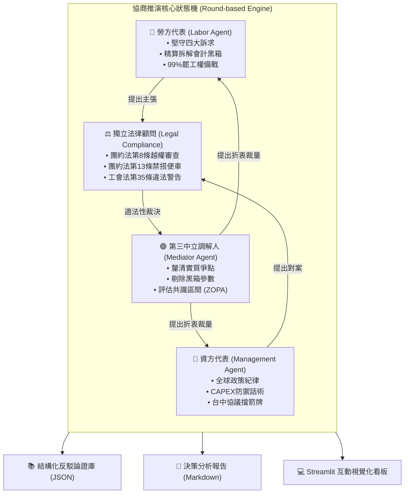

# ⚖️ LaborBargainLab (罷工談判協商模擬器)

> **A Multi-Agent Strike Negotiation Simulator & Labor Decision Support System**  
> *四代理人沙盤推演 × 財務黑箱破解 × 勞動法理合規裁判*

[](https://opensource.org/licenses/MIT)
[](https://www.python.org/downloads/)
[](https://streamlit.io/)

---

## 📖 專案緣起與真實歷史背景

本專案以 **2026 年台灣半導體產業首場重大勞資爭議與合法罷工——「美光科技（Micron Taiwan）台中與桃園廠風暴」** 為核心實戰案例。

在生成式 AI 與高頻寬記憶體（HBM）爆炸性成長的背景下，跨國巨頭創下歷史天價獲利，但基層高壓輪班工程師與技術員卻面臨制度不透明、利潤分配極端不對等的困境。本系統旨在為勞工與工會幹部提供**沙盤推演**、**破解資方會計黑箱**與**法理合規決策支援**，讓勞方在談判桌上能夠「有憑有據、邏輯嚴密」地痛擊資方不合理辯詞。

### 📌 案例核心爭議焦點
1. **勞方四大核心訴求：**
   * **獎金制度改革**：廢除主管主觀考核且有天花板的 IPP，比照同業（台積電、三星、SK海力士）明訂固定透明的分潤公式並每季發放；
   * **2026 財年歷史性超額盈餘一次性補償**：依稅後淨利 15% 提撥特別分潤（換算約等同 **83 個月**基數），嚴格限工會會員專屬；
   * **全面禁止秋後算帳**：白紙黑字明訂違約罰則，保障罷工與工會幹部（《工會法》第35條）；
   * **落實禁搭便車**：依《團體協約法》第13條，工會成果僅由會員共享。
2. **兩廠局勢分歧與 10/21 秘密協約風暴：**
   * **桃園工會**：經兩次調解破局，全體無記名投票以 **99% 高票通過取得合法罷工權**，並於 10/22 發動 24 小時警告性罷工；
   * **台中工會**：9 名協商代表未獲會員大會授權（原授權僅限 10/22 協商），竟於 **10/21 提前私下與資方簽訂附帶保密條款與和平條款之秘密協議**，引發基層強烈不滿與無權代理撤銷抗爭。
3. **資方「五重削弱公式」財務陷阱：**
   * 資方公關稿宣稱產線年薪破 200 萬、工程師近 600 萬，實則算式為：
   $$\text{獎金池} = (\text{當季淨利} - \text{下季預估 CAPEX}) \times 70\% \ (\text{扣留30\%}) \times \text{2026百萬定錨比例}$$
   * 且發放為 **50% 現金 + 50% 鎖定一年之股票**，一旦下季高層拉高設備採購，分潤池直接歸零！

---

## 🏛️ 系統架構 (System Architecture)

系統採用**四代理人狀態機架構（Four-Agent State Machine）**，模擬真實勞資協商會議室：



---

## ⚡ 核心功能特色

### 1. 🤖 4-LLM 全自動沙盤推演
* 四大代理人各自具備獨立的專業 Prompt 與博弈策略，能自動進行多回合攻防辯駁；
* 支援多種 LLM 提供商（OpenAI, Gemini），在未配置 API Key 時亦能以內建的高擬真戰略啟發引擎離線流暢運作。

### 2. 🧮 資方五重陷阱 vs 勞方分潤精算機
* 即時計算「下一季預估 CAPEX 扣除」對獎金池的致命影響，以互動式圖表展示：
  * 當資方編列高額資本支出時，如何將獎金池歸零；
  * 打七折（扣留 30% 預期外現金）之重疊抽頭破綻；
  * 對照同業（台積電分潤制）與勞方訴求的實質現金落差。

### 3. 📜 勞動四法適法性診斷雷達
* **台中 10/21 協議診斷**：依據《團體協約法》第8條、民法第170條，自動判定其為「無權代理」且「不具團約法定拘束力」；
* **禁搭便車適法性審查**：引用《團體協約法》第13條，提供勞方反駁資方「差別待遇」說詞之法理武器；
* **不當勞動行為偵測**：引用《工會法》第35條，即時抓取資方的秋後算帳威脅與分化操作。

### 4. 📚 結構化反駁論證庫 (Rebuttal Knowledge Base)
* 自動將推演產生的精彩攻防抽取為知識庫卡片（`data/arguments_db/rebuttals.json`）；
* 包含「謬誤話術」、「勞方反擊重點」、「具體法條」與「一擊必殺話術」，可供工會談判幹部直接調用。

---

## 🚀 快速上手 (Quick Start)

### 1. 安裝環境
專案使用 Python 3.10+，請先複製專案並安裝依賴套件：

```bash
git clone https://github.com/clovermikelai/LaborBargainLab.git
cd LaborBargainLab

# 安裝所需套件
pip install -r requirements.txt
```

### 2. (選用) 配置 LLM API Key
若要啟用雲端大語言模型即時生成，請複製環境變數範本並填入您的 Key：
```bash
cp .env.example .env
# 編輯 .env 填入 OPENAI_API_KEY 或 GEMINI_API_KEY
```
*(若未填入 API Key，系統將自動啟動內建的高擬真啟發引擎，功能完整無阻)*

### 3. 命令列一鍵執行沙盤推演
```bash
python scripts/run_simulation.py --rounds 4
```
* 執行完成後將自動在 `reports/latest_simulation_report.md` 生成完整推演報告，並將反駁論證寫入資料庫。

### 4. 啟動 Streamlit 互動視覺化介面
```bash
streamlit run app.py
```
開啟瀏覽器前往 `http://localhost:8501`，即可操作：
* 四方談判對話與即時罷工機率指標；
* 財務黑箱計算機滑桿試算；
* 法律合規與無權代理診斷器；
* 勞方論證武器庫檢索。

### 5. 執行單元測試
```bash
python -m unittest discover tests
```

---

## 📂 專案檔案結構

```text
LaborBargainLab/
├── README.md                      # 專案詳細說明與架構手冊
├── LICENSE                        # MIT 開源授權協議
├── requirements.txt               # 專案依賴庫清單
├── .env.example                   # 環境變數設定範本
├── .gitignore                     # Git 忽略設定
│
├── data/
│   ├── cases/
│   │   └── micron_taiwan_2026.json   # 美光案核心背景、四大訴求、公式資料
│   ├── laws/
│   │   └── taiwan_labor_laws.json    # 台灣勞動四法條文與法理鑑定標準
│   └── arguments_db/
│       └── rebuttals.json            # [自動累積] 結構化反駁論證庫
│
├── src/
│   ├── agents/                    # 四大談判代理人邏輯
│   │   ├── base_agent.py          # 基礎代理人類 (支援 LLM & 本地引擎)
│   │   ├── labor_agent.py         # 勞方代表 (堅守訴求、拆解黑箱)
│   │   ├── management_agent.py    # 資方代表 (全球政策、防守防線)
│   │   ├── legal_advisor_agent.py # 獨立法律顧問 (合規審查、紅黃綠燈)
│   │   └── mediator_agent.py      # 中立調解人 (ZOPA評估、利益收斂)
│   ├── models/
│   │   ├── financial_calculator.py# 財務五重陷阱與勞方分潤計算模型
│   │   └── legal_checker.py       # 團約法第8條、第13條與工會法第35條審查器
│   ├── engine/
│   │   ├── orchestrator.py        # 回合制協商狀態機調度器
│   │   └── knowledge_extractor.py # 論證反駁知識抽取器
│   └── utils/
│       └── reporter.py            # Markdown 決策分析報告產出器
│
├── scripts/
│   └── run_simulation.py          # CLI 命令列一鍵推演腳本
├── app.py                         # Streamlit 互動式 Web 看板
└── tests/
    └── test_simulation.py         # 單元測試集 (財務、法規、流程驗證)
```

---

## ⚖️ 授權協議 (License)

本專案採用 **[MIT License](LICENSE)** 開源授權，歡迎各工會團體、勞動法學研機構與開發者共同參與完善！
